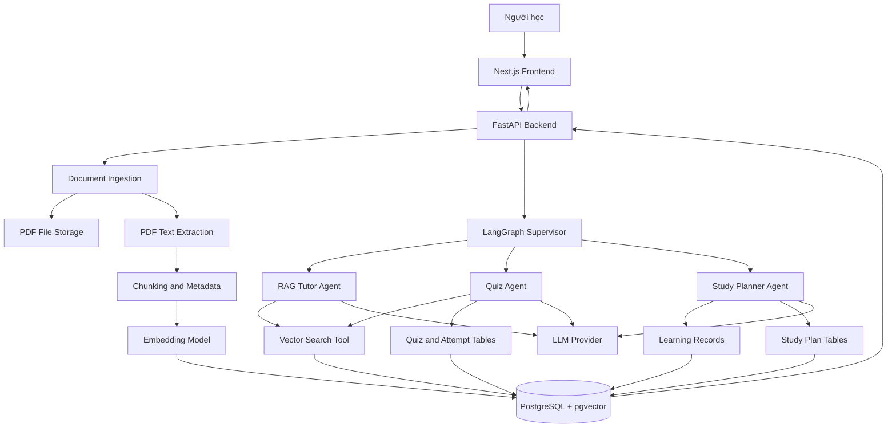

# ĐẶC TẢ DỰ ÁN STUDYMATE AI
## Trợ lý học tập thông minh ứng dụng RAG và Multi-Agent

**Phiên bản:** 1.0  
**Thời gian dự kiến:** 16 tuần  
**Lĩnh vực:** Trí tuệ nhân tạo ứng dụng trong giáo dục  
**Môn học thử nghiệm:** Cơ sở dữ liệu  
**Công nghệ trọng tâm:** RAG, Vector Search, Multi-Agent, LLM, PostgreSQL và pgvector.

---

# I. TỔNG QUAN DỰ ÁN

## 1. Tên dự án

**StudyMate AI – Trợ lý học tập thông minh cá nhân hóa sử dụng RAG và Multi-Agent.**

## 2. Bài toán cần giải quyết

Trong quá trình tự học, người học thường gặp các vấn đề:

- Tài liệu học tập nằm rải rác trong nhiều file PDF hoặc tài liệu trực tuyến.
- Khó tìm nhanh thông tin cần thiết trong các tài liệu dài.
- Các công cụ AI thông thường có thể đưa ra câu trả lời không có căn cứ rõ ràng từ giáo trình.
- Người học phải tự tạo câu hỏi và tự đánh giá mức độ hiểu bài.
- Việc lập kế hoạch học tập chưa dựa trên kết quả kiểm tra và những chủ đề người học còn yếu.

StudyMate AI được xây dựng nhằm hỗ trợ người học giải quyết các vấn đề trên trong một hệ thống thống nhất.

## 3. Mục tiêu dự án

Xây dựng một ứng dụng web cho phép người học:

1. Tải lên tài liệu học tập.
2. Đặt câu hỏi và nhận câu trả lời dựa trên tài liệu đã tải lên, kèm nguồn tham chiếu.
3. Tự động tạo bài kiểm tra từ nội dung tài liệu.
4. Làm bài, nhận điểm và xem các câu trả lời sai.
5. Theo dõi kết quả học tập theo từng chủ đề.
6. Nhận kế hoạch ôn tập cá nhân hóa dựa trên kết quả học tập và thời gian có thể học.

Hệ thống sử dụng RAG để truy xuất kiến thức và Multi-Agent để điều phối các nhiệm vụ hỏi đáp, tạo bài kiểm tra và lập kế hoạch học tập.

## 4. Phạm vi thử nghiệm

Phiên bản đầu tiên tập trung vào môn Cơ sở dữ liệu, gồm 5 chủ đề:

1. Tổng quan về cơ sở dữ liệu và hệ quản trị cơ sở dữ liệu.
2. Mô hình dữ liệu quan hệ.
3. Bảng, khóa chính, khóa ngoại và các mối quan hệ.
4. Truy vấn dữ liệu bằng SQL cơ bản.
5. Giao dịch và các nguyên tắc bảo đảm tính toàn vẹn dữ liệu.

Phạm vi này đủ để kiểm tra khả năng truy xuất thông tin giữa nhiều tài liệu, tạo câu hỏi theo chủ đề và cá nhân hóa việc ôn tập.

Dự án không đặt mục tiêu xây dựng một nền tảng LMS hoàn chỉnh, không huấn luyện mô hình ngôn ngữ từ đầu và không yêu cầu hỗ trợ nhiều môn học ngay trong phiên bản đầu tiên.

---

# II. ĐỐI TƯỢNG SỬ DỤNG VÀ KỊCH BẢN

## 1. Đối tượng sử dụng

**Người học:** Tải tài liệu, hỏi đáp, làm bài kiểm tra, theo dõi tiến độ và nhận kế hoạch học tập.

**Quản trị viên:** Quản lý tài liệu thử nghiệm, kiểm tra trạng thái xử lý tài liệu và theo dõi hoạt động của hệ thống.

Trong MVP, có thể sử dụng một nhóm tài liệu dùng chung và một số tài khoản thử nghiệm. Nếu cho phép người dùng tự tải tài liệu, hệ thống phải bảo đảm người dùng chỉ truy cập được tài liệu mà họ được phép sử dụng.

## 2. Kịch bản sử dụng chính

### Kịch bản 1: Hỏi đáp từ tài liệu

Người học tải lên giáo trình Cơ sở dữ liệu, sau đó hỏi:

“Khóa chính và khóa ngoại khác nhau như thế nào? Hãy lấy ví dụ minh họa.”

StudyMate AI tìm các đoạn liên quan trong kho kiến thức, tổng hợp câu trả lời và hiển thị tên tài liệu, số trang hoặc mục tương ứng.

Nếu tài liệu không chứa đủ thông tin, hệ thống phải thông báo rằng chưa tìm thấy đủ bằng chứng, thay vì khẳng định một đáp án không có căn cứ.

### Kịch bản 2: Tạo bài kiểm tra

Người học chọn chủ đề SQL cơ bản và yêu cầu tạo 10 câu trắc nghiệm.

Quiz Agent sử dụng nội dung được truy xuất từ tài liệu để tạo câu hỏi, đáp án, lời giải thích và thông tin nguồn.

Người học làm bài và nhận điểm sau khi nộp bài.

### Kịch bản 3: Lập kế hoạch học tập cá nhân hóa

Giả sử người học đạt 60% ở chủ đề SQL nhưng đạt 90% ở chủ đề mô hình dữ liệu quan hệ.

Người học cho biết mình có thể học 20 phút mỗi ngày.

Study Planner Agent sử dụng điểm số, chủ đề còn yếu và thời gian học để xây dựng kế hoạch ôn tập 7 ngày. Kế hoạch được lưu lại để người học xem và cập nhật tiến độ.

---

# III. CÁC CHỨC NĂNG CỦA HỆ THỐNG

## 1. Quản lý tài liệu

Mã chức năng: FR-01.

Hệ thống cần cho phép:

- Tải lên tài liệu PDF.
- Hiển thị tên, dung lượng, nguồn và trạng thái xử lý.
- Lưu thông tin giấy phép sử dụng tài liệu.
- Trích xuất nội dung và chia thành các đoạn nhỏ.
- Tạo embedding cho từng đoạn.
- Lưu nội dung và embedding vào PostgreSQL + pgvector.
- Thông báo thành công hoặc lỗi khi xử lý tài liệu.
- Xóa tài liệu và các đoạn dữ liệu liên quan khi người dùng được phép thực hiện.

Mỗi tài liệu có trạng thái: `uploaded`, `processing`, `indexed` hoặc `failed`.

Phiên bản đầu tiên ưu tiên PDF có văn bản có thể trích xuất. Tài liệu scan cần OCR có thể bổ sung ở giai đoạn sau.

## 2. Hỏi đáp sử dụng RAG

Mã chức năng: FR-02.

Hệ thống cần:

- Nhận câu hỏi bằng ngôn ngữ tự nhiên.
- Tạo embedding cho câu hỏi bằng cùng mô hình embedding đã dùng khi lập chỉ mục tài liệu.
- Tìm các đoạn kiến thức phù hợp bằng vector search.
- Đưa câu hỏi và các đoạn tìm được vào LLM.
- Tạo câu trả lời dựa trên bằng chứng được truy xuất.
- Hiển thị nguồn tham chiếu, tên tài liệu và số trang khi có.
- Báo thiếu bằng chứng khi kết quả truy xuất không đủ tin cậy.

Các tham số ban đầu để thử nghiệm:

- Kích thước chunk: khoảng 500–800 token.
- Chunk overlap: khoảng 80–120 token.
- Số đoạn truy xuất: top 4–6.
- Giới hạn độ dài tài liệu và câu hỏi để kiểm soát chi phí.

Đây là cấu hình xuất phát, không phải các giá trị tối ưu cố định. Cần điều chỉnh bằng bộ câu hỏi đánh giá thực tế.

## 3. Tạo và chấm bài kiểm tra

Mã chức năng: FR-03.

Người học được chọn:

- Chủ đề cần kiểm tra.
- Số lượng câu hỏi.
- Độ khó.
- Dạng câu hỏi.

Phiên bản đầu tiên ưu tiên câu hỏi trắc nghiệm một đáp án đúng. Có thể bổ sung câu hỏi tự luận ngắn sau khi chức năng cốt lõi hoạt động ổn định.

Mỗi câu hỏi cần lưu:

- Nội dung câu hỏi.
- Các phương án trả lời nếu là trắc nghiệm.
- Đáp án chuẩn.
- Giải thích đáp án.
- Chủ đề và mức độ khó.
- Các đoạn tài liệu làm căn cứ tạo câu hỏi.

Đối với trắc nghiệm, hệ thống chấm điểm bằng đáp án chuẩn đã lưu. Không nên để LLM tự quyết định điểm trắc nghiệm sau mỗi lần làm bài.

## 4. Theo dõi tiến độ học tập

Mã chức năng: FR-04.

Hệ thống lưu:

- Số bài kiểm tra đã hoàn thành.
- Điểm từng bài.
- Tỷ lệ trả lời đúng theo chủ đề.
- Những chủ đề thường trả lời sai.
- Lịch sử ôn tập.

Từ các dữ liệu này, hệ thống xây dựng hồ sơ mức độ thành thạo của người học theo từng chủ đề.

## 5. Lập kế hoạch học tập cá nhân hóa

Mã chức năng: FR-05.

Người học cung cấp:

- Mục tiêu học tập.
- Số ngày muốn lập kế hoạch.
- Thời gian có thể học mỗi ngày.
- Hạn hoàn thành nếu có.

Study Planner Agent sử dụng thông tin trên cùng dữ liệu kết quả học tập để tạo kế hoạch gồm:

- Ngày học.
- Chủ đề cần ôn.
- Hoạt động học tập đề xuất.
- Thời lượng dự kiến.
- Bài kiểm tra hoặc nhiệm vụ thực hành.
- Trạng thái hoàn thành.

Kế hoạch do AI tạo phải được kiểm tra để tránh phân bổ thời gian vượt quá giới hạn người học đã cung cấp.

## 6. Dashboard

Mã chức năng: FR-06.

Dashboard hiển thị:

- Số tài liệu đã lập chỉ mục.
- Số bài kiểm tra đã làm.
- Điểm số gần nhất.
- Điểm trung bình theo chủ đề.
- Chủ đề cần ôn tập.
- Kế hoạch học tập hiện tại.

---

# IV. KIẾN TRÚC KỸ THUẬT

## 1. Công nghệ đề xuất

### Frontend

- Next.js.
- TypeScript.
- Tailwind CSS.

Nhiệm vụ: xây dựng giao diện, tải tài liệu, hiển thị hội thoại, làm bài kiểm tra và dashboard.

### Backend

- Python.
- FastAPI.

Nhiệm vụ: xử lý API, quản lý tài liệu, truy xuất kiến thức, gọi LLM và điều phối Agent.

### AI orchestration

- LangGraph: xây dựng workflow và điều phối các Agent.
- LangChain: có thể sử dụng cho các thành phần RAG và tích hợp mô hình nếu phù hợp.

Không cần sử dụng nhiều framework có chức năng trùng lặp.

### Database

- PostgreSQL.
- pgvector.

Nhiệm vụ: lưu dữ liệu nghiệp vụ, các đoạn văn bản và embedding.

### File storage

Có thể sử dụng Supabase Storage hoặc dịch vụ lưu file tương đương để lưu PDF gốc.

### Các thư viện bổ trợ

- PyMuPDF: trích xuất văn bản từ PDF.
- Một thư viện tokenization phù hợp với mô hình đã chọn.
- SDK của một nhà cung cấp LLM.
- pytest: kiểm thử backend và workflow.
- Docker: đóng gói môi trường triển khai.

Chỉ nên chọn một nhà cung cấp LLM trong MVP. Có thể chọn OpenAI hoặc Gemini tùy chi phí, khả năng truy cập và chất lượng đầu ra thực tế.

## 2. Sơ đồ kiến trúc

Người dùng tương tác với Next.js. Các yêu cầu được gửi đến FastAPI, sau đó backend gọi workflow LangGraph để định tuyến tới Agent thích hợp.

Luồng RAG truy xuất dữ liệu trong PostgreSQL + pgvector. Luồng tạo quiz và lập kế hoạch sử dụng thêm các bảng dữ liệu nghiệp vụ. File PDF gốc được lưu trong File Storage.

Sơ đồ thể hiện kiến trúc logic. Trong triển khai thật, các bảng quiz và kế hoạch học tập vẫn thuộc PostgreSQL; chúng không nhất thiết phải là các database riêng biệt.

---

# V. THIẾT KẾ LƯU TRỮ DỮ LIỆU

## 1. Nguyên tắc phân chia

StudyMate AI sử dụng hai loại lưu trữ chính:

**File Storage:** lưu file tài liệu gốc.

**PostgreSQL + pgvector:** lưu metadata, nội dung các đoạn văn bản, embedding và dữ liệu quản lý học tập.

Không cần triển khai thêm một vector database độc lập trong phiên bản đầu tiên.

## 2. Các bảng dữ liệu

### Bảng `documents`

Lưu thông tin về tài liệu.

Các trường đề xuất:

- `id`: mã tài liệu.
- `owner_id`: người sở hữu hoặc người được phép truy cập.
- `title`: tên tài liệu.
- `source_url`: URL nguồn nếu có.
- `storage_path`: đường dẫn file.
- `license`: giấy phép hoặc điều kiện sử dụng.
- `status`: trạng thái lập chỉ mục.
- `created_at`: thời điểm tạo.

### Bảng `document_chunks`

Lưu các đoạn kiến thức được chia nhỏ từ tài liệu.

Các trường đề xuất:

- `id`: mã đoạn.
- `document_id`: mã tài liệu nguồn.
- `chunk_index`: thứ tự đoạn.
- `page_number`: số trang nếu xác định được.
- `section`: tên chương hoặc mục.
- `content`: nội dung đoạn văn bản.
- `embedding`: vector embedding.
- `created_at`: thời điểm tạo.

Đây là bảng trực tiếp phục vụ vector search.

### Bảng `profiles`

Lưu thông tin hồ sơ người học cần thiết cho ứng dụng, liên kết với tài khoản xác thực.

### Bảng `quiz_sets`

Lưu thông tin bộ đề:

- Người tạo.
- Tên bộ đề.
- Chủ đề.
- Số lượng câu hỏi.
- Độ khó.
- Thời điểm tạo.

### Bảng `quiz_questions`

Lưu nội dung câu hỏi, các phương án, đáp án chuẩn, lời giải thích và thông tin nguồn tài liệu.

### Bảng `quiz_attempts`

Lưu mỗi lần người học làm bài, điểm số, thời gian làm và trạng thái hoàn thành.

### Bảng `quiz_responses`

Lưu câu trả lời của người học cho từng câu hỏi, đáp án đúng/sai và điểm đạt được.

### Bảng `user_topic_mastery`

Lưu mức độ thành thạo theo chủ đề, số lần làm bài và các chỉ số được hệ thống tính toán.

### Bảng `study_plans`

Lưu mục tiêu, thời gian dự kiến, ngày bắt đầu, ngày kết thúc và trạng thái kế hoạch.

### Bảng `study_plan_items`

Lưu nhiệm vụ học tập cụ thể của từng ngày, thời lượng, chủ đề và trạng thái hoàn thành.

### Bảng `chat_sessions` và `chat_messages`

Lưu phiên trò chuyện và nội dung trao đổi nếu người dùng bật chức năng lưu lịch sử.

### Bảng `agent_runs` (tùy chọn)

Lưu thông tin thực thi workflow, Agent được gọi, công cụ được sử dụng, thời gian xử lý và trạng thái thành công hoặc thất bại. Không lưu API key hoặc dữ liệu nhạy cảm vào log.

## 3. Quan hệ giữa dữ liệu

- Một tài liệu có nhiều đoạn văn bản.
- Một bộ đề có nhiều câu hỏi.
- Một người học có nhiều lần làm bài.
- Một lần làm bài có nhiều câu trả lời.
- Một người học có nhiều bản ghi mức độ thành thạo theo chủ đề.
- Một kế hoạch học tập có nhiều nhiệm vụ học tập.
- Một câu hỏi có thể tham chiếu đến nhiều đoạn kiến thức làm căn cứ.

Nếu cần truy xuất nguồn của câu hỏi, nên dùng bảng liên kết như `quiz_question_sources` để lưu quan hệ giữa câu hỏi và các đoạn tài liệu. Không nên chỉ lưu tên nguồn dưới dạng một chuỗi khó kiểm tra.

---

# VI. THIẾT KẾ RAG PIPELINE

## 1. Giai đoạn nạp tài liệu

Bước 1: Người dùng tải PDF lên.

Bước 2: Backend kiểm tra định dạng, dung lượng và quyền truy cập.

Bước 3: Lưu file gốc vào File Storage.

Bước 4: Tạo bản ghi trong bảng `documents`.

Bước 5: PyMuPDF trích xuất văn bản và thông tin trang.

Bước 6: Chia văn bản thành các chunk theo cấu trúc đoạn và tiêu đề, đồng thời áp dụng giới hạn token.

Bước 7: Gắn metadata gồm `document_id`, `page_number`, `section`, `chunk_index` và thông tin nguồn.

Bước 8: Gọi mô hình embedding để chuyển mỗi chunk thành vector.

Bước 9: Lưu văn bản, metadata và embedding vào `document_chunks`.

Bước 10: Cập nhật trạng thái tài liệu thành `indexed`.

## 2. Giai đoạn truy xuất

Khi nhận câu hỏi:

1. Kiểm tra người dùng có quyền truy cập tài liệu liên quan.
2. Tạo embedding cho câu hỏi.
3. Tìm các chunk gần nhất theo độ tương đồng vector.
4. Áp dụng bộ lọc metadata nếu người dùng chọn một tài liệu hoặc chủ đề cụ thể.
5. Kiểm tra kết quả truy xuất có đủ liên quan hay không.
6. Đưa các đoạn được chọn vào ngữ cảnh của LLM.
7. Yêu cầu LLM trả lời theo bằng chứng và chỉ ra nguồn.
8. Kiểm tra cấu trúc trích dẫn trước khi trả kết quả cho giao diện.

Nếu kết quả truy xuất không đủ tốt, hệ thống phải thông báo chưa đủ căn cứ. Ngưỡng tin cậy cần được hiệu chỉnh bằng bộ dữ liệu kiểm thử; không nên coi điểm tương đồng vector là xác suất đúng.

## 3. Cấu trúc câu trả lời

Một câu trả lời RAG nên gồm:

- Nội dung trả lời trực tiếp.
- Giải thích hoặc ví dụ.
- Danh sách nguồn tham chiếu.
- Tên tài liệu và số trang khi có.
- Thông báo thiếu bằng chứng nếu không thể trả lời đáng tin cậy.

Hệ thống không được tự tạo số trang, tên tài liệu hoặc nguồn trích dẫn.

---

# VII. THIẾT KẾ MULTI-AGENT

## 1. Supervisor Agent

Vai trò: điều phối yêu cầu của người học.

Nhiệm vụ:

- Phân loại ý định: hỏi kiến thức, tạo bài kiểm tra hay lập kế hoạch.
- Chuyển yêu cầu đến Agent tương ứng.
- Truyền các thông tin cần thiết trong trạng thái workflow.
- Xử lý lỗi và trả kết quả cuối cùng.

Supervisor không cần tự giải quyết tất cả nhiệm vụ. Nên ưu tiên định tuyến rõ ràng, giới hạn số lần thử lại và không tạo vòng lặp Agent vô hạn.

## 2. RAG Tutor Agent

Vai trò: trợ giảng kiến thức.

Công cụ được phép sử dụng:

- `search_knowledge`: truy xuất các đoạn tài liệu liên quan.
- `get_document_metadata`: lấy tên tài liệu, nguồn và thông tin trang.
- `validate_citations`: kiểm tra nguồn được trích dẫn có thực sự thuộc các đoạn đã truy xuất.

Quy trình:

1. Nhận câu hỏi.
2. Truy xuất kiến thức.
3. Kiểm tra độ liên quan của bằng chứng.
4. Tạo câu trả lời có căn cứ.
5. Trả nội dung cùng danh sách nguồn.

Điều kiện thất bại: không tìm thấy bằng chứng phù hợp hoặc nguồn không đủ để kết luận.

## 3. Quiz Agent

Vai trò: tạo và quản lý bài kiểm tra.

Công cụ được phép sử dụng:

- `search_knowledge`.
- `generate_quiz`.
- `save_quiz`.
- `grade_attempt`.
- `update_topic_mastery`.

Quy trình:

1. Nhận yêu cầu tạo bài kiểm tra.
2. Truy xuất nội dung thuộc chủ đề.
3. Sinh câu hỏi theo cấu trúc quy định.
4. Kiểm tra đáp án và tính rõ ràng.
5. Lưu bộ đề và nguồn tham chiếu.
6. Khi người học nộp bài, chấm điểm bằng đáp án chuẩn.
7. Cập nhật tiến độ học tập.

Trong MVP, hệ thống nên ưu tiên trắc nghiệm có đáp án xác định. Câu hỏi tự luận và chấm điểm bằng LLM là chức năng mở rộng, cần đánh giá riêng.

## 4. Study Planner Agent

Vai trò: tạo kế hoạch học tập dựa trên dữ liệu thực tế.

Công cụ được phép sử dụng:

- `get_learning_summary`.
- `get_topic_mastery`.
- `get_user_availability`.
- `create_study_plan`.
- `update_plan_progress`.

Quy trình:

1. Đọc điểm số và lịch sử học tập.
2. Xác định chủ đề cần ôn.
3. Thu thập mục tiêu và thời gian học của người dùng.
4. Sinh kế hoạch.
5. Kiểm tra thời lượng, ngày học và tổng thời gian.
6. Lưu kế hoạch vào PostgreSQL.
7. Trả kế hoạch cho giao diện.

Agent phải sử dụng kết quả học tập đã lưu, không được tự suy đoán điểm số của người học.

## 5. Cách tổ chức workflow bằng LangGraph

Workflow gồm các node chính:

- `classify_intent`
- `retrieve_context`
- `answer_with_citations`
- `generate_quiz`
- `grade_attempt`
- `load_learning_profile`
- `generate_study_plan`
- `validate_output`
- `save_result`

Điều kiện chuyển node dựa trên loại yêu cầu, trạng thái dữ liệu và kết quả thực thi.

Mỗi workflow cần có giới hạn số lần thử lại, timeout, kiểm tra dữ liệu đầu ra và xử lý lỗi. Không cần để các Agent tự do gọi lẫn nhau không giới hạn.

---

# VIII. THIẾT KẾ API BACKEND

Các API đề xuất cho FastAPI:

| Endpoint | Phương thức | Chức năng |
|---|---|---|
| `/api/documents` | GET | Danh sách tài liệu được phép truy cập |
| `/api/documents/upload` | POST | Tải tài liệu lên |
| `/api/documents/{id}` | DELETE | Xóa tài liệu và dữ liệu liên quan |
| `/api/documents/{id}/index` | POST | Bắt đầu hoặc chạy lại lập chỉ mục |
| `/api/chat` | POST | Hỏi đáp qua RAG và Supervisor |
| `/api/quizzes/generate` | POST | Tạo bộ đề |
| `/api/quizzes/{id}` | GET | Lấy nội dung bộ đề |
| `/api/quizzes/{id}/attempts` | POST | Nộp bài và chấm điểm |
| `/api/learning-summary` | GET | Lấy tiến độ học tập |
| `/api/study-plans/generate` | POST | Tạo kế hoạch học tập |
| `/api/study-plans` | GET | Danh sách kế hoạch |
| `/api/study-plans/{id}/items/{item_id}` | PATCH | Cập nhật trạng thái nhiệm vụ |

Các endpoint chỉ là thiết kế ban đầu. Khi lập trình, cần định nghĩa request, response, schema validation, xác thực và xử lý lỗi cụ thể cho từng API.

---

# IX. THIẾT KẾ GIAO DIỆN

Phiên bản đầu tiên gồm 5 màn hình chính.

## 1. Dashboard

Hiển thị điểm số, chủ đề cần ôn, kế hoạch hiện tại và hoạt động gần đây.

## 2. Knowledge Library

Cho phép tải PDF, xem trạng thái lập chỉ mục, tên tài liệu, nguồn và trạng thái lỗi.

## 3. AI Tutor

Giao diện hội thoại gồm câu hỏi, câu trả lời, nguồn tham chiếu và liên kết tới tài liệu.

## 4. Quiz Center

Cho phép chọn chủ đề, tạo bài kiểm tra, làm bài, xem kết quả và đọc giải thích đáp án.

## 5. Study Planner

Hiển thị kế hoạch theo ngày, thời lượng, chủ đề, nhiệm vụ và trạng thái hoàn thành.

Ưu tiên giao diện dễ sử dụng, dữ liệu rõ ràng và có thể kiểm chứng. Không cần đầu tư quá nhiều thời gian vào hiệu ứng giao diện trước khi RAG và các workflow hoạt động ổn định.

---

# X. CHIẾN LƯỢC CHUẨN BỊ DỮ LIỆU

## 1. Tài liệu kiến thức

Nguồn khởi đầu có thể là Thư viện Học liệu Mở Việt Nam:

https://voer.edu.vn/

Ưu tiên các tài liệu liên quan đến cơ sở dữ liệu, hệ quản trị cơ sở dữ liệu và phân tích, thiết kế hệ thống thông tin.

Mỗi tài liệu cần được kiểm tra giấy phép cụ thể trước khi sử dụng. Lưu tên tác giả nếu có, URL nguồn, giấy phép, ngày thu thập và thông tin phiên bản.

## 2. Bộ dữ liệu kiểm thử RAG

Tạo khoảng 50 câu hỏi có đáp án chuẩn và nguồn đối chiếu, bao gồm:

- Câu hỏi tìm thông tin trực tiếp.
- Câu hỏi yêu cầu giải thích khái niệm.
- Câu hỏi so sánh hai khái niệm.
- Câu hỏi cần tổng hợp thông tin từ nhiều đoạn.
- Câu hỏi có cách diễn đạt khác với tài liệu.
- Câu hỏi không thể trả lời bằng tài liệu hiện có.

Bổ sung khoảng 10 câu hỏi không đủ dữ kiện để kiểm tra khả năng từ chối trả lời khi thiếu bằng chứng.

Bộ kiểm thử phải được người thực hiện kiểm tra thủ công, bao gồm câu trả lời chuẩn và vị trí nguồn hỗ trợ.

## 3. Bộ dữ liệu Quiz

Chuẩn bị một bộ câu hỏi tham khảo có đáp án, lời giải thích, chủ đề và mức độ khó.

Không cần tạo toàn bộ dữ liệu quiz bằng tay ngay từ đầu. Có thể dùng AI sinh bản nháp từ tài liệu, sau đó kiểm tra và chuẩn hóa các câu hỏi dùng làm dữ liệu đánh giá.

## 4. Dữ liệu học tập giả lập

Tạo khoảng 5 hồ sơ học tập giả lập, mỗi hồ sơ có:

- Điểm theo chủ đề.
- Lịch sử làm bài.
- Các chủ đề thường trả lời sai.
- Mục tiêu học tập.
- Thời gian có thể học mỗi ngày.

Các hồ sơ này dùng để kiểm thử Study Planner Agent. Không cần sử dụng dữ liệu cá nhân của học sinh thật.

---

# XI. KẾ HOẠCH TRIỂN KHAI 16 TUẦN

## Giai đoạn 1: Phân tích và thiết kế — Tuần 1–2

Công việc:

- Chốt yêu cầu và phạm vi MVP.
- Chọn 3–5 chủ đề.
- Thu thập tài liệu hợp lệ.
- Thiết kế schema PostgreSQL.
- Thiết kế API và workflow.
- Tạo bộ câu hỏi đánh giá ban đầu.

Đầu ra: đặc tả yêu cầu, sơ đồ kiến trúc, sơ đồ dữ liệu và bộ tài liệu thử nghiệm.

## Giai đoạn 2: Xây dựng pipeline dữ liệu — Tuần 3–4

Công việc:

- Cấu hình PostgreSQL + pgvector.
- Tạo bảng `documents` và `document_chunks`.
- Xây dựng chức năng tải PDF.
- Trích xuất văn bản bằng PyMuPDF.
- Chia chunk và gắn metadata.
- Tạo embedding và lưu dữ liệu.
- Kiểm tra việc lập chỉ mục và xóa dữ liệu.

Đầu ra: tài liệu có thể được nạp và tìm kiếm trong vector database.

## Giai đoạn 3: Hoàn thiện RAG Tutor — Tuần 5–6

Công việc:

- Xây dựng API hỏi đáp.
- Tạo embedding câu hỏi.
- Truy xuất top-k.
- Tích hợp LLM.
- Hiển thị nguồn tham chiếu.
- Xử lý câu hỏi ngoài phạm vi.
- Tạo bộ kiểm thử và đo chất lượng.

Đầu ra: hệ thống hỏi đáp có trích dẫn, có khả năng báo thiếu bằng chứng.

## Giai đoạn 4: Triển khai Supervisor và Quiz Agent — Tuần 7–8

Công việc:

- Xây dựng workflow LangGraph.
- Định tuyến giữa hỏi đáp và tạo bài kiểm tra.
- Thiết kế cấu trúc dữ liệu câu hỏi.
- Sinh câu hỏi từ tài liệu.
- Kiểm tra đáp án và nguồn.
- Viết kiểm thử cho từng nhánh workflow.

Đầu ra: hệ thống điều phối được các yêu cầu cơ bản và tạo được bộ đề.

## Giai đoạn 5: Quiz Center và quản lý kết quả — Tuần 9–10

Công việc:

- Xây dựng giao diện làm bài.
- Lưu bộ đề và đáp án.
- Chấm trắc nghiệm bằng đáp án chuẩn.
- Lưu lịch sử làm bài.
- Tính điểm theo chủ đề.
- Hiển thị kết quả và lời giải thích.

Đầu ra: người học có thể tạo đề, làm bài và xem lịch sử kết quả.

## Giai đoạn 6: Study Planner Agent — Tuần 11–12

Công việc:

- Xây dựng bảng theo dõi mức độ thành thạo.
- Xây dựng API tổng hợp tiến độ.
- Tạo hồ sơ học tập mẫu.
- Sinh kế hoạch theo điểm yếu và thời gian rảnh.
- Kiểm tra tính hợp lệ của kế hoạch.
- Lưu và cập nhật trạng thái kế hoạch.

Đầu ra: hệ thống tạo được kế hoạch học tập dựa trên dữ liệu đã lưu.

## Giai đoạn 7: Hoàn thiện giao diện và triển khai — Tuần 13–14

Công việc:

- Hoàn thiện Dashboard, Knowledge Library, AI Tutor, Quiz Center và Study Planner.
- Bổ sung xác thực và phân quyền.
- Kiểm tra quyền truy cập file.
- Kiểm tra xử lý lỗi, timeout và giới hạn tải file.
- Đóng gói backend bằng Docker.
- Triển khai frontend, backend và database.

Đầu ra: ứng dụng có thể truy cập trên môi trường demo.

## Giai đoạn 8: Đánh giá và hoàn thiện hồ sơ — Tuần 15–16

Công việc:

- Chạy bộ kiểm thử RAG.
- Đánh giá chất lượng câu hỏi.
- Kiểm tra tính đúng đắn của kế hoạch học tập.
- Đo thời gian phản hồi và chi phí.
- Ghi nhận lỗi và sửa các lỗi ưu tiên cao.
- Chuẩn bị báo cáo kỹ thuật, sơ đồ kiến trúc và video demo.

Đầu ra: sản phẩm MVP, bộ đánh giá, báo cáo kết quả và kịch bản trình diễn.

---

# XII. TIÊU CHÍ ĐÁNH GIÁ THÀNH CÔNG

Các con số dưới đây là mục tiêu đề xuất cần kiểm chứng, không phải kết quả đã đạt được.

## 1. Đánh giá RAG

- Recall@5 mục tiêu từ 80% trở lên trên bộ câu hỏi có nguồn chuẩn.
- Tỷ lệ câu trả lời có trích dẫn được nguồn hỗ trợ đạt mục tiêu từ 90% trở lên khi kiểm tra thủ công.
- Hệ thống phát hiện và từ chối các câu hỏi thiếu bằng chứng.
- Nguồn và số trang hiển thị phải khớp với tài liệu thực tế.

Recall@5 được tính trên các câu hỏi có đáp án và đoạn nguồn chuẩn đã được xác định trước.

## 2. Đánh giá Quiz Agent

- Câu hỏi rõ ràng, có đáp án hợp lệ và bám sát tài liệu.
- Các câu trắc nghiệm được chấm đúng theo đáp án chuẩn.
- Câu hỏi có nguồn tham chiếu.
- Không sinh câu hỏi thiếu dữ kiện hoặc có nhiều đáp án đúng ngoài dự kiến.

Có thể đặt mục tiêu ít nhất 90% câu hỏi trong mẫu đánh giá được người kiểm tra xác nhận là rõ ràng, trả lời được và có căn cứ.

## 3. Đánh giá Study Planner Agent

- Kế hoạch phù hợp với điểm yếu của người học.
- Thời lượng không vượt quá thời gian đã cung cấp.
- Nhiệm vụ học tập có thể thực hiện được.
- Kế hoạch được lưu và cập nhật trạng thái chính xác.

## 4. Đánh giá Multi-Agent

- Yêu cầu được định tuyến đúng Agent.
- Agent sử dụng đúng công cụ và dữ liệu.
- Workflow có thể ghi nhận trạng thái thành công hoặc thất bại.
- Không xảy ra vòng lặp gọi Agent không giới hạn.

## 5. Đánh giá vận hành

Theo dõi thêm thời gian phản hồi, tỷ lệ lỗi, chi phí API và khả năng xử lý khi mô hình hoặc database không phản hồi.

---

# XIII. KỊCH BẢN DEMO TRƯỚC HỘI ĐỒNG

Thời lượng đề xuất: 6–8 phút.

**Phần 1 – Nạp tài liệu (khoảng 1 phút)**

Tải lên một giáo trình PDF và trình bày trạng thái lập chỉ mục thành công.

**Phần 2 – Hỏi đáp có trích dẫn (khoảng 1–2 phút)**

Hỏi về sự khác nhau giữa khóa chính và khóa ngoại. Mở nguồn trích dẫn và chỉ ra nội dung hỗ trợ câu trả lời.

**Phần 3 – Kiểm tra khả năng từ chối (khoảng 1 phút)**

Hỏi một câu mà tài liệu không cung cấp đủ dữ kiện. Hệ thống phải thông báo chưa đủ căn cứ.

**Phần 4 – Tạo và làm bài kiểm tra (khoảng 1–2 phút)**

Yêu cầu Quiz Agent tạo 5 câu hỏi, hoàn thành bài và hiển thị điểm số.

**Phần 5 – Cá nhân hóa học tập (khoảng 1–2 phút)**

Mở kết quả học tập, chỉ ra chủ đề có điểm thấp, sau đó yêu cầu Study Planner Agent lập kế hoạch 7 ngày với thời lượng học cụ thể.

**Phần 6 – Chứng minh kiến trúc (khoảng 30 giây)**

Trình bày sơ đồ LangGraph, nhật ký thực thi và dữ liệu được lưu trong PostgreSQL.

Điểm quan trọng là demo phải chứng minh các Agent thực sự gọi công cụ và sử dụng dữ liệu tương ứng, không chỉ là ba chatbot với ba lời nhắc khác nhau.

---

# XIV. AN TOÀN, QUYỀN RIÊNG TƯ VÀ KIỂM SOÁT RỦI RO

## 1. RAG trả lời sai

Giải pháp: lưu bộ đáp án chuẩn, kiểm tra nguồn, đánh giá chất lượng truy xuất và cho phép hệ thống từ chối khi thiếu bằng chứng.

## 2. Chi phí LLM tăng

Giải pháp: giới hạn độ dài đầu vào, số chunk truy xuất và số lần gọi Agent; chỉ gọi LLM khi cần thiết.

## 3. Prompt injection trong tài liệu

Nội dung tài liệu được coi là dữ liệu không đáng tin cậy, không phải chỉ dẫn cho hệ thống. Agent không được thực thi lệnh hoặc làm theo yêu cầu nhúng trong PDF để tiết lộ dữ liệu hay vượt quyền truy cập.

## 4. Rò rỉ dữ liệu giữa người dùng

Giải pháp: kiểm tra quyền sở hữu hoặc quyền truy cập ở backend, áp dụng bộ lọc truy vấn, bảo vệ file và không tin vào `user_id` do frontend tự gửi mà chưa xác thực.

## 5. Tài liệu không rõ giấy phép

Giải pháp: lưu URL, tác giả và giấy phép; ưu tiên tài liệu được phép sử dụng; không mặc định rằng tài liệu miễn phí tải xuống đồng nghĩa với được phép tái phân phối hoặc đưa vào sản phẩm AI.

## 6. Agent tạo kế hoạch không hợp lý

Giải pháp: kiểm tra tổng thời lượng, giới hạn số nhiệm vụ và cho phép người học chỉnh sửa kế hoạch trước khi sử dụng.

---

# XV. TIÊU CHÍ HOÀN THÀNH MVP

Dự án được coi là hoàn thành phiên bản đầu tiên khi:

1. Người dùng có thể tải PDF và hệ thống lập chỉ mục thành công.
2. RAG Tutor trả lời dựa trên tài liệu và có nguồn tham chiếu kiểm chứng được.
3. Hệ thống nhận biết các trường hợp không đủ bằng chứng.
4. Quiz Agent tạo được bài trắc nghiệm có đáp án và nguồn.
5. Người học có thể làm bài, nhận điểm và lưu lịch sử.
6. Study Planner Agent đọc được dữ liệu học tập và tạo kế hoạch phù hợp với giới hạn thời gian.
7. Supervisor định tuyến được ba loại yêu cầu.
8. Dữ liệu được lưu trong PostgreSQL + pgvector và File Storage.
9. Có bộ kiểm thử, số liệu đánh giá và kịch bản demo tái hiện được.
10. Có kiểm tra cơ bản về phân quyền, xử lý lỗi và an toàn dữ liệu.

---

# XVI. HƯỚNG TRIỂN KHAI ƯU TIÊN

Không nên phát triển toàn bộ chức năng cùng một lúc. Thứ tự ưu tiên là:

**Bước 1:** Chuẩn bị 3–5 tài liệu hợp lệ về Cơ sở dữ liệu và xây dựng bộ câu hỏi đánh giá có nguồn chuẩn.

**Bước 2:** Xây dựng PostgreSQL + pgvector, pipeline PDF → chunk → embedding → vector search.

**Bước 3:** Hoàn thiện RAG Tutor và kiểm chứng chất lượng câu trả lời trước khi phát triển Agent khác.

**Bước 4:** Bổ sung Supervisor và Quiz Agent, sau đó triển khai chức năng làm bài và lưu điểm.

**Bước 5:** Xây dựng Study Planner Agent sử dụng kết quả học tập thực tế.

**Bước 6:** Hoàn thiện frontend, phân quyền, triển khai và đánh giá.

Nguyên tắc quan trọng nhất là: **RAG phải hoạt động và được đánh giá trước; Multi-Agent được bổ sung sau để phối hợp các nhiệm vụ có dữ liệu và công cụ rõ ràng.**

Với cách làm này, StudyMate AI không chỉ là một ứng dụng chat dùng LLM mà là một hệ thống có dữ liệu nguồn, cơ chế truy xuất, quy trình điều phối, kết quả học tập có cấu trúc và tiêu chí đánh giá có thể kiểm chứng.